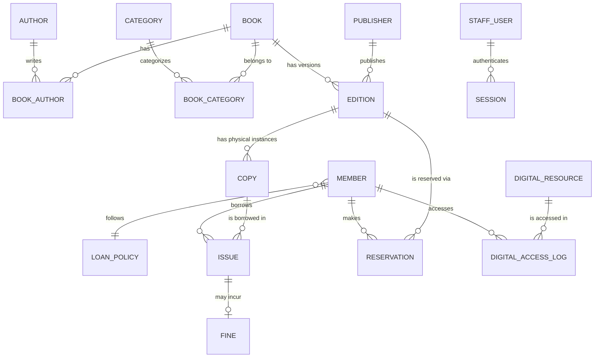

# Project Report: Design and Implementation of a Database Management System for Library Circulation and Digital Resource Management

## 1. Introduction
The Library Management System is a comprehensive, offline-first application designed to manage the circulation of physical books and the access logs of digital resources. This project demonstrates the practical application of core Database Management System (DBMS) concepts, including schema normalization (3NF), complex SQL queries, views, triggers, and transactions, all wrapped in a custom-built, lightweight web server.

## 2. Technology Stack
To ensure maximum portability and zero external dependencies, the system was built entirely using standard technologies:
- **Backend**: Python 3.9+ (Standard Library only: `http.server`, `sqlite3`, `hashlib`, `urllib`)
- **Database**: SQLite3 (with a PostgreSQL-compatible DDL variant provided for enterprise scaling)
- **Frontend**: Vanilla HTML5, CSS3, and JavaScript (No external frameworks or CDNs)
- **Aesthetics**: Custom Dark Mode UI featuring Glassmorphism, CSS variables, and modern hover transitions.

## 3. Database Design & Architecture

### 3.1 Entity-Relationship (ER) Diagram
Below is the logical structure of the database represented as an ER Diagram.

### 3.2 Schema Normalization (3NF)
The database has been rigorously normalized to the Third Normal Form (3NF) to eliminate data redundancy and prevent insert/update/delete anomalies:
- **1NF**: All attributes are atomic. Multi-valued attributes (like authors or categories for a single book) have been split into junction tables (`Book_Author`, `Book_Category`).
- **2NF**: All non-key attributes are fully functionally dependent on the primary key. For example, `publisher_name` depends entirely on `publisher_id`, not on the `edition_id`.
- **3NF**: There are no transitive dependencies. For example, `fine_per_day` is stored in `Loan_Policy` based on `member_type`, rather than being duplicated inside the `Member` table.

## 4. Business Logic & Constraints

The system relies heavily on the database engine to enforce business rules using Constraints and Triggers:

### Constraints
- **Foreign Keys**: `ON DELETE RESTRICT` is used to prevent the deletion of a Member if they have active loans. `ON DELETE CASCADE` is used for junction tables and fines.
- **Check Constraints**: `due_date >= issue_date`, `fine_amount >= 0`, and `status` enforcement (e.g., 'Available', 'Issued', 'Lost').

### Triggers (Automated Logic)
1. **`trg_issue_check_member`**: Automatically blocks book issues if the member's status is 'Suspended'.
2. **`trg_update_copy_status_issue`**: Automatically updates a copy's status to 'Issued' when an issue record is created.
3. **`trg_calculate_fine_on_return`**: Automatically calculates fines upon book return by taking `(return_date - due_date) * fine_per_day`. It cross-references the `Loan_Policy` table dynamically.
4. **`trg_process_reservation_queue`**: Automatically transitions a returned book's status to 'Reserved' if there is an active reservation waiting for that specific edition.

## 5. System Features & Working

### 5.1 Custom HTTP Server (Backend)
The backend avoids frameworks like Django or Flask, instead utilizing Python's low-level `http.server.BaseHTTPRequestHandler`. 
- **Routing**: URL paths are manually parsed and routed to specific controller functions.
- **Session Management**: A custom in-memory dictionary tracks authenticated users via secure `session_id` cookies.
- **Template Engine**: A custom `render()` function dynamically injects SQL query results into HTML layouts using string replacement (`{{ variable }}`).

### 5.2 User Interface (Frontend)
- **Login Portal**: A standalone, centered Glassmorphism card authenticated securely against SHA-256 password hashes.
- **Dashboard**: Features dynamic KPI cards (Total Copies, Issued Books, Overdue Books) that act as buttons leading to dedicated data lists.
- **Sidebar Navigation**: Seamless switching between Search, Issue, Return, Fines, and Reports.

### 5.3 Core Modules
- **Search Catalogue**: Allows searching across books, authors, and categories using SQL `LIKE` operators.
- **Circulation (Issue/Return)**: Handles the physical movement of copies. Entering an accession number triggers the complex backend DAO logic to verify availability, process the transaction, and fire database triggers.
- **Fines Management**: Lists unpaid fines calculated dynamically by SQLite triggers. Allows librarians to mark them as paid.
- **Reports**: Leverages SQL Views (`v_available_titles`, `v_overdue_copies`) to display real-time complex aggregates without running heavy joins on the fly.
- **Admin Panel**: An exclusive dashboard for the 'Admin' role that allows dynamic updates to global Loan Policies, Member deletions, and full database factory resets.

## 6. Conclusion
This Library DBMS successfully demonstrates a robust, normalized, and highly functional relational database architecture. By implementing complex business logic entirely within the database layer (via triggers and views) and coupling it with a lightweight, zero-dependency Python server, the project achieves a highly portable, performant, and reliable software solution.
